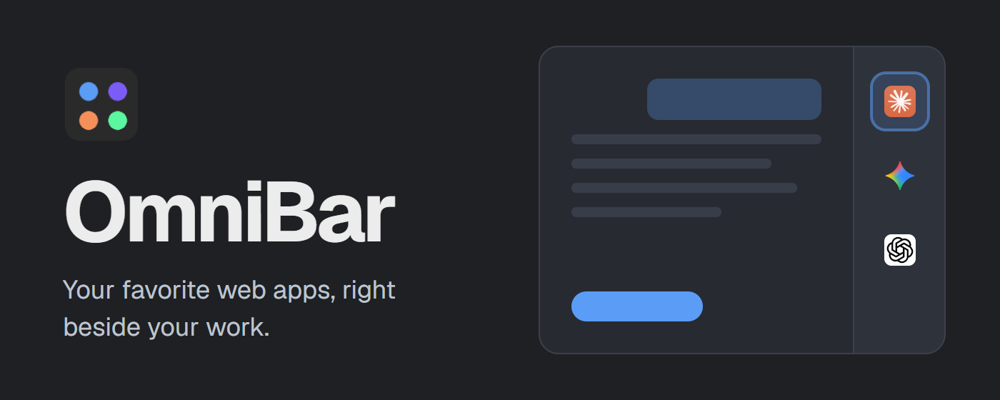

# OmniBar

A customizable sidebar extension for Firefox and Chromium-based browsers that keeps web apps and AI assistants one click away.

Originally created as a replacement for the Microsoft Edge sidebar. The upstream demo shows the Chromium edition.

https://github.com/user-attachments/assets/425baec1-02f0-4161-9ef3-0ae854397c3e

## Features

- **App dock.** Add, edit, remove, and drag to reorder apps. Right-click an app to open it in a tab or side window, or to sign in separately.
- **Default page.** Choose an app to open automatically with the sidebar. Use the toolbar button or `Alt+Z` to return to the dock.
- **Page actions.** Allow tab access to copy a summary prompt, question prompt, or the current page link. Paste the prompt into the app you want to use.
- **Appearance.** Follow the system theme or choose light or dark mode.
- **Local settings.** OmniBar saves your app list and preferences on your device. Import or export your apps from Settings.

## Build both browser editions

Run `python3 build.py` (or `.\build.ps1` in PowerShell with Python installed). The archives are written to `dist/omnibar-firefox.zip` and `dist/omnibar-chromium.zip`. Pass `--browser firefox` or `--browser chromium` to the Python command to build one edition.

## Install in Chromium

Extract `dist/omnibar-chromium.zip`, open `chrome://extensions`, enable **Developer mode**, and click **Load unpacked**. Select the extracted directory containing `manifest.json`. Press `Alt+Z` or click OmniBar in the toolbar to open its side panel.

## Install in Firefox

1. Open Firefox 128 or later and go to `about:debugging#/runtime/this-firefox`.
2. Click **Load Temporary Add-on** and select the root `manifest.json` or the manifest from the extracted Firefox archive.
3. Click OmniBar in the toolbar or press `Alt+Z` to open the dock. To change the shortcut, use **Settings → Shortcut → Change**.

Firefox removes temporary add-ons when it restarts. Load the manifest again to continue testing.

## Browser behavior

Chromium keeps the dock visible beside its embedded apps and supports prompt insertion, a loading indicator, and a per-app desktop viewport.

### Firefox

Apps open as native sidebar pages, with OmniBar’s app icons and settings visible beside them. The pop-out button hides the dock in the same sidebar. For Claude it also switches from `/new` to `/recents`. Firefox may ask for access to a custom site before it can display the dock alongside it. Use the toolbar button or `Alt+Z` to return to the dock. If Firefox has suspended OmniBar and the first shortcut press closes the current app, press it again to reopen the dock.

## Privacy

OmniBar has no servers, accounts, analytics, or ads. See the [Firefox privacy policy](PRIVACY.md) or the [Chromium privacy policy](chromium/PRIVACY.md).

## Support the Project
If you find this plugin useful, please leave a star on GitHub or consider supporting its development!

## License

