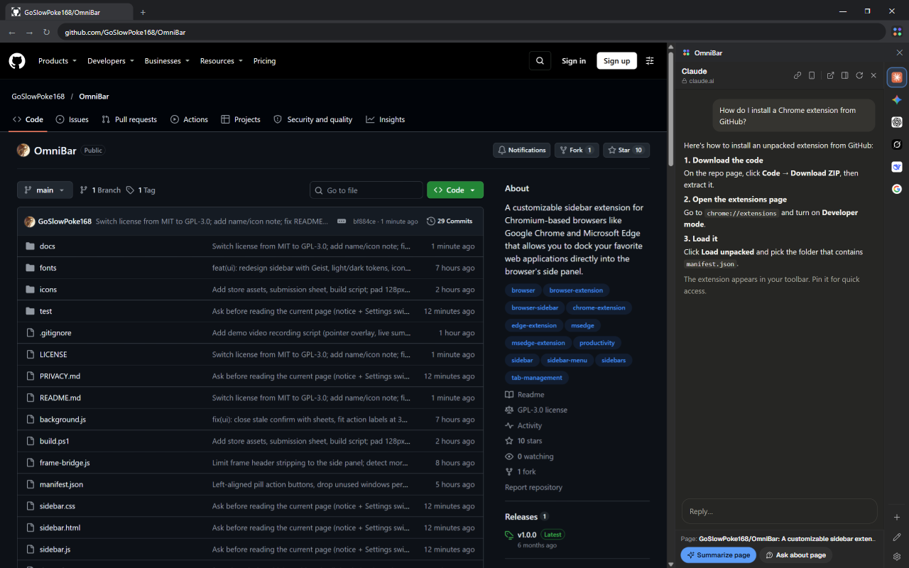

# OmniBar

A customizable sidebar extension for Chromium-based browsers like Google Chrome, Microsoft Edge, Brave, and Opera / Opera GX that allows you to dock your favorite web applications directly into the browser's side panel. 

Created as a replacement for the Microsoft Edge sidebar since Microsoft removed it for no reason...

## Features

- **Customizable App Dock:** Add, edit, remove, and reorder your favorite web apps via a sleek, drag-and-drop interface.
- **Global Toggle Shortcut:** Quickly open and close the sidebar using a customizable keyboard shortcut (default: `Alt+Z`).
- **Summarize Page & Ask About Page:** Send the current tab's address to the open app in one click. OmniBar asks before reading the current page and shows which page it will use.
- **Default Page:** Open your favorite app automatically whenever the sidebar opens.
- **Light & Dark Themes:** Follows Chrome's theme, or pick one in Settings.
- **Desktop or Mobile View:** Choose per app whether sites get their desktop or mobile layout.
- **Sign-in Help:** When a site can't sign in inside the sidebar, OmniBar shows simple steps to sign in once in a separate window.
- **Saved Preferences:** Your apps and settings are saved on your device, so your setup stays intact after restarting the browser. Import and export your app list anytime.

## How to Use

- Click an icon to open it in the sidebar
- Right-click an icon to open it elsewhere, sign in, edit, or remove it
- Click the pencil to enter edit mode, then drag to reorder
- Click + to add a new app and the gear for Settings
- Use **Summarize page** or **Ask about page** at the bottom of the sidebar to send the current page to the open app

## Compatibility

| Browser | Support Status |
| :--- | :--- |
| **Google Chrome** |  |
| **Microsoft Edge** |  |
| **Brave** |  |
| **Opera / Opera GX** |  |
| **Mozilla Firefox** |  |

*Note: This extension relies on the Manifest V3 `sidePanel` API. Browsers lacking support for this specific API (like Mozilla Firefox) cannot run the extension currently, though Firefox support is planned for the future.*

## Installation

A Chrome Web Store listing is on the way. Until then, load OmniBar as an unpacked extension in Developer Mode.

### General Steps

1. **Download the code:** Download the latest release `.zip` file from the Releases page (or clone the repository) and extract it to a folder on your computer.
2. Open your browser and navigate to the Extensions page (see the [Browser-Specific Links](#browser-specific-links) below).
3. Enable **Developer mode**.
4. Click the **Load unpacked** button.
5. Select the extracted folder containing this extension's source code.
6. (Optional) Configure the keyboard shortcut by navigating to the Shortcuts page.

### Browser-Specific Links

| Browser | Extensions Page | Shortcuts Page |
| :--- | :--- | :--- |
| **Google Chrome** | `chrome://extensions/` | `chrome://extensions/shortcuts` |
| **Microsoft Edge** | `edge://extensions/` | `edge://extensions/shortcuts` |
| **Brave** | `brave://extensions/` | `brave://extensions/shortcuts` |
| **Opera / Opera GX** | `opera://extensions/` | `opera://extensions/shortcuts` |

## Technical Notes

To allow external websites to load inside the sidebar's `<iframe>` context, this extension utilizes the `declarativeNetRequest` API to remove frame-blocking HTTP response headers. This only applies to pages loaded inside OmniBar's side panel; normal tabs are not affected. Some websites might still not load due to client-side bot-mitigation techniques (such as Cloudflare Turnstile), which block rendering within an iframe.

## Privacy

OmniBar has no servers, accounts, analytics, or ads. See the [Privacy Policy](PRIVACY.md).

## TODO

- [x] Add a page button to extract context from the current page

## Support the Project
If you find this plugin useful, please leave a star on GitHub or consider supporting its development!

## License

OmniBar is licensed under the [GNU General Public License v3.0](LICENSE). Copyright (C) 2026 Jeremy Hou. Versions released before November 19, 2026 were licensed under MIT.

The OmniBar name and icon are not covered by this license and may not be used to identify other extensions.
